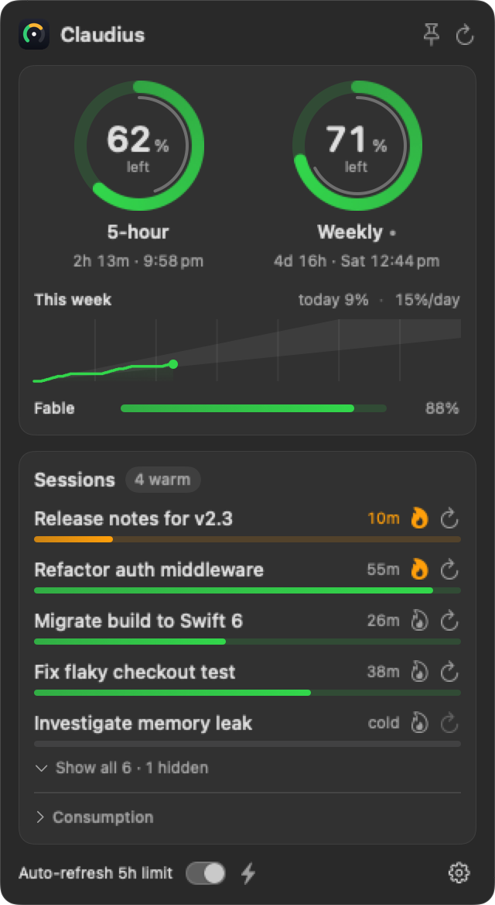
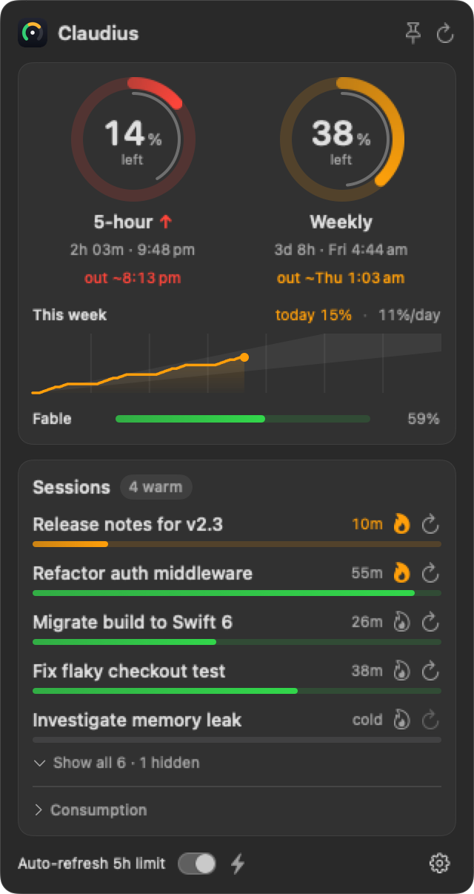
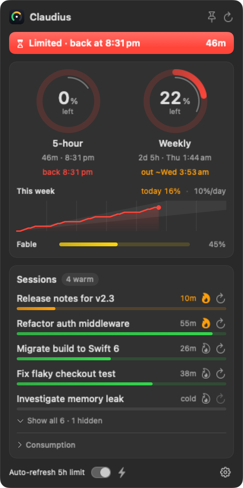
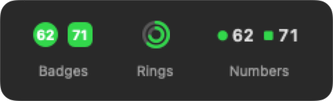
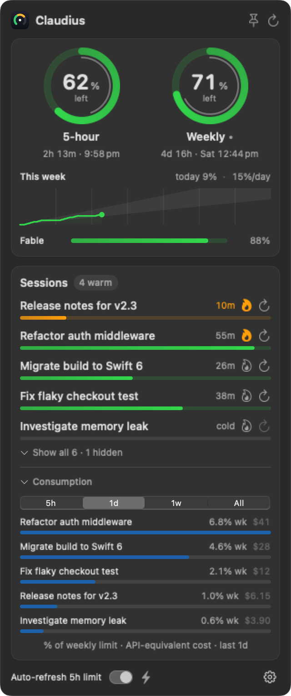

# Claudius — Claude Code usage limits in your macOS menu bar

**Know how much of your Claude Code plan is left — and when it'll run out — without opening a dashboard or typing `/usage`.**

<p align="center">
  
  
  
  <a href="LICENSE"></a>
  <a href="https://github.com/Abd-K/Claudius/releases"></a>
  <a href="https://github.com/Abd-K/Claudius/stargazers"></a>
</p>

<p align="center">
  <picture>
    <source media="(prefers-color-scheme: light)" srcset="docs/popover-light.png">
    
  </picture>
</p>

Claudius is a lightweight, open-source **macOS menu bar app** for [Claude Code](https://claude.com/claude-code) power users on **Pro and Max plans**. Your **5-hour session** and **weekly** limits sit in the menu bar; one click shows when each resets, **when you'll run out at your current pace**, how much you can spend per day to last the week, and which sessions ate the most. It reads the sign-in Claude Code already keeps on your Mac — no login, no account, no telemetry.

> ⚠️ Unofficial and not affiliated with Anthropic. It reads an **undocumented** usage endpoint via the token Claude Code keeps in your Keychain, so it can break without notice. Personal tool, shared as-is.

## Install

Requires macOS 13+, the Xcode command-line tools (`xcode-select --install`), `python3`, and a signed-in Claude Code CLI.

```sh
git clone https://github.com/Abd-K/Claudius.git
cd Claudius && ./install.sh
```

That installs the `claude-usage` backend to `~/.local/bin`, builds Claudius into `/Applications` and launches it. Re-run it to upgrade.

## Why Claudius?

- **Never get surprised by a limit.** Both limits live in your menu bar as colour-coded gauges, and the panel tells you **"out ~8:07 pm"** the moment your pace means you'll hit the wall before it resets.
- **Spend the week evenly.** See what you've used **today** and an even **daily budget** for the rest of the week, against a trend line of the week so far.
- **Get told, not surprised.** Native alerts when a limit runs low, when you hit it, and when it's back.
- **See what's eating your quota.** Sessions ranked by their share of your weekly limit over the **last 5h / day / week / all time**, **model-weighted** so Opus, Sonnet, Haiku and Fable compare fairly.
- **Keep long chats fast.** Optional cache keep-alive keeps a conversation's prompt cache warm — and it *refuses to warm a dead cache*, so it never wastes usage.
- **100% local & private.** Reads the token from your macOS **Keychain** and transcripts from `~/.claude`. Nothing leaves your machine except the call to Anthropic's own usage endpoint.

<p align="center">
  
  &nbsp;&nbsp;
  
  <br><em>When it's tight, Claudius forecasts the run-out. When you're limited, it says exactly when you're back.</em>
</p>

## Features

| | |
|---|---|
| **Menu-bar gauges** | 5-hour + weekly % left, colour-coded — as badges, rings or plain numbers |
| **Run-out forecast** | "out ~8:07 pm" when your pace beats the reset; silent when you're fine |
| **Weekly trend** | This week's usage line, today's share, and a per-day budget to last the week |
| **Limit alerts** | Running low (20% left), limit reached, limit back |
| **Reset countdowns** | Countdown plus clock time for every limit, model-scoped ones (e.g. Fable) included |
| **Per-session consumption** | Share of your weekly limit + API-equivalent cost, by 5h / 1d / 1w / all |
| **Cache warmth + keep-alive** | Per session; never warms a cold cache |
| **Auto-refresh 5h limit** | Starts a fresh 5-hour window the minute the last one resets |
| **CLI included** | `claude-usage` works standalone in scripts and CI |

## What everything means

**In the menu bar** — your two limits, in the style you pick from the ⚙︎ menu:

<p align="center">
  
</p>

- **Circle = your 5-hour limit, square = your weekly limit** (in Rings: outer = 5-hour, inner = weekly). The number is how much you have **left**; the colour runs green → yellow → orange → red as it gets low — sooner if you're burning fast.
- **A small arrow** appears when your weekly pace is off: **↑** burning through it fast, **↓** well under. No arrow means you're on track.

**Click it** to open the panel:

- **Rings** — the thick ring is how much of the limit is left; the thin inner ring is how much *time* is left before it resets. Fuel ahead of time means you'll make it.
- **out ~time** — at the rate so far, that's when the limit runs dry. Only shown when it's before the reset.
- **This week** — usage so far against a shaded 10–20%-a-day band, with **today**'s share and an even **%/day** budget for what's left.
- **Sessions** — your recent Claude Code chats and how long each stays fast to resume. The **🔥 flame** keeps one warm automatically; **↻** refreshes it now (uses a little quota).
- **Consumption** — which chats used the most of your allowance.
- **Auto-refresh 5h limit** — starts a fresh 5-hour window the moment the current one resets, so you're not left waiting on it.

<p align="center">
  
  <br><em>Consumption — which sessions used the most, by 5h / day / week / all time.</em>
</p>

## How it works

The macOS app (SwiftUI, `MenuBarExtra`) shells out to a small Python backend, `claude-usage`, which:

1. reads the `Claude Code-credentials` OAuth token from your login **Keychain**,
2. calls Anthropic's usage endpoint (the one behind `/usage`) for session/weekly/model limits, and
3. parses your local `~/.claude` transcripts for per-session cache warmth and consumption — deduped by message id, so streaming rewrites and resumed sessions aren't double-counted.

The app keeps a week of its own readings in `~/Library/Application Support/Claudius` to draw the trend — the endpoint only reports the present. Because the token lives only in the Keychain and the app runs the `claude` CLI for keep-alive, it **can't be sandboxed** for the Mac App Store.

<details>
<summary><strong>How do I check my Claude Code usage without opening a dashboard?</strong></summary>

Claudius surfaces the same numbers as the in-app `/usage` command, but always-on in your menu bar. If you prefer the terminal, the bundled `claude-usage` CLI prints the same data:

```sh
claude-usage            # live view of session / weekly / model limits
claude-usage check      # prints true/false — are you rate-limited right now?
claude-usage sessions   # recent sessions + cache warmth
claude-usage cost --since 1d   # which sessions consumed the most today
```

</details>

<details>
<summary><strong>Do I need to log in? How does Claudius authenticate?</strong></summary>

**There's no login, and Claudius never sees your credentials.** It doesn't have an account system. It reads the OAuth token that **Claude Code already stores in your macOS Keychain** when you run `claude` and sign in — so if you can use Claude Code, Claudius works. Nothing is sent anywhere except the call to Anthropic's own usage endpoint.

Claude Code refreshes that token as you use it, so this is normally invisible. If the token ever expires and can't be refreshed, the app says **"Claude Code CLI sign-in needed"** and offers a **Sign in** button that opens Terminal running `claude auth login` — Anthropic's own login flow does the work, and Claudius picks the new token up automatically.

</details>

<details>
<summary><strong>Can I get alerts even when the app isn't running?</strong></summary>

Claudius alerts on its own while it runs. For a background watcher that works without it, install the bundled launchd job:

```sh
sed "s|__HOME__|$HOME|g" com.ark.claude-usage.plist > ~/Library/LaunchAgents/com.ark.claude-usage.plist
launchctl bootstrap gui/$(id -u) ~/Library/LaunchAgents/com.ark.claude-usage.plist
```

</details>

## Contributing

Issues and PRs welcome. `scripts/snapshot.sh` regenerates every screenshot in this README from demo data, so UI changes can ship with fresh images.

If Claudius saves you from a surprise rate limit, a ⭐ helps other Claude Code users find it.

## License

MIT — see [LICENSE](LICENSE).

## Keywords

Claude Code usage tracker · Claude rate limit menu bar · Claude Max weekly limit macOS · Claude Pro 5-hour session window · Anthropic usage monitor · claude-usage CLI · token quota tracker for macOS · CodexBar alternative · ccusage alternative · Claude-Code-Usage-Monitor alternative.
